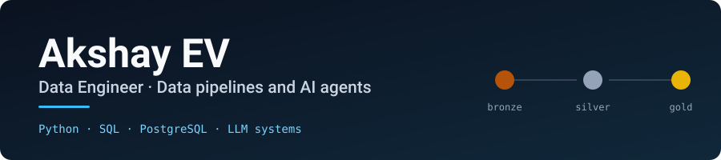
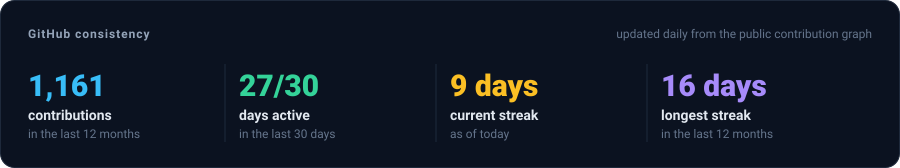
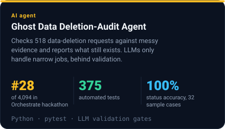
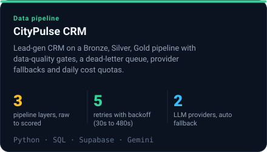

  

  <a href="https://www.linkedin.com/in/akshay-ev">LinkedIn</a> &nbsp;·&nbsp;
  <a href="mailto:akshayev47@gmail.com">akshayev47@gmail.com</a> &nbsp;·&nbsp;
  Thrissur, Kerala, India

I'm a data engineer who builds data pipelines and LLM-powered agents in Python and SQL. My focus is making these systems reliable: data contracts and quality gates on every layer, automated tests written before the code, and validation around every model output so nothing reaches production unchecked.

I'm currently in my final year of a B.Tech in Information Technology at Cochin University of Science and Technology (CUSAT), graduating in 2027, and **open to data engineering and AI engineering roles** (remote, hybrid or on-site).

### Highlights

- **Top 1% of 4,094 participants:** ranked #28 in the HackerRank Orchestrate hackathon with the [Ghost Data Deletion-Audit Agent](https://github.com/akshayev/ghost-data-deletion-audit-agent), backed by 375 automated tests.
- **Shipped and running:** [CityPulse CRM](https://github.com/akshayev/citypulse-crm) is [live](https://citypulse-crm.vercel.app), with CI, automated database backups and 39 merged pull requests.
- **Steady delivery:** over 350 merged pull requests in the last 12 months, each one a small, reviewable change.

  

## Featured work

<!--PROJECTS:START-->
<table>
  <tr>
    <td width="50%" valign="top">
      
    </td>
    <td width="50%" valign="top">
      
    </td>
  </tr>
</table>
<!--PROJECTS:END-->

## Technical skills

| Area | Tools |
| --- | --- |
| Languages | Python, SQL |
| Data engineering | Medallion (Bronze/Silver/Gold) pipelines, Pydantic data contracts, PostgreSQL, Supabase |
| AI and LLMs | Gemini, Groq, multi-provider fallback, output validation |
| Quality and delivery | pytest, golden-output tests, GitHub Actions, Git |

## Experience

- **Full Stack Developer Intern**, Xpar · May 2026 – Oct 2026
- **Website Developer Intern**, Strokx Technologies · May 2025 – Jun 2025
- **Programming Intern**, Keltron · Apr 2024 – May 2024 · Python scripting for data processing and validation

## Certifications

- HackerRank Certified Software Engineer
- Google × Kaggle 5-Day AI Agents Intensive
