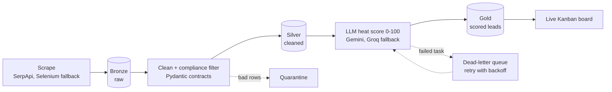

  

  <b>I build data pipelines and AI agents that check their own work.</b> 
  Python and SQL are what I write and own. I direct AI coding agents for the rest, then test and review what they build.

  📍 Thrissur, Kerala, India &nbsp;·&nbsp; 🟢 Open to data engineering and AI agent roles: remote, hybrid, or on-site 
  📫 <a href="mailto:akshayev47@gmail.com">akshayev47@gmail.com</a> &nbsp;·&nbsp; <a href="https://www.linkedin.com/in/akshay-ev">LinkedIn</a>

---

## 🔥 Recent activity

Updated automatically from my public GitHub activity.

<!--RECENT_ACTIVITY:START-->
- 🔨 [akshayev](https://github.com/akshayev/akshayev): [docs: add profile README](https://github.com/akshayev/akshayev/commit/9b018dbf6169c0fd57b381f4de75f504c306f75b) · _today_
- 🔀 opened PR in [portfolio-main](https://github.com/akshayev/portfolio-main): [docs: replace absolute local paths with relative links](https://github.com/akshayev/portfolio-main/pull/14) · _today_
- 🔀 opened PR in [CityPulse-AI-Market-Intelligence-Agent](https://github.com/akshayev/CityPulse-AI-Market-Intelligence-Agent): [docs: fix placeholder clone URL in README](https://github.com/akshayev/CityPulse-AI-Market-Intelligence-Agent/pull/2) · _today_
- 🔀 opened PR in [citypulse-crm](https://github.com/akshayev/citypulse-crm): [docs: remove stray dots from README header](https://github.com/akshayev/citypulse-crm/pull/43) · _today_
- 🔀 opened PR in [job-seeker-agent](https://github.com/akshayev/job-seeker-agent): [docs: remove stray dot from README title](https://github.com/akshayev/job-seeker-agent/pull/2) · _today_
- 🔨 [citypulse-crm](https://github.com/akshayev/citypulse-crm): [Fix formatting in README header section](https://github.com/akshayev/citypulse-crm/commit/e80aaae4a1689f7f87b009d83bb9ae01b152dc64) · _2d ago_
- 🔨 [ghost-data-deletion-audit-agent](https://github.com/akshayev/ghost-data-deletion-audit-agent): [Add contributing guide, issue and PR templates](https://github.com/akshayev/ghost-data-deletion-audit-agent/commit/f8c74d7f1c4e256b11dc681249a2beb397dbc4eb) · _8d ago_
- 🔨 [ghost-data-deletion-audit-agent](https://github.com/akshayev/ghost-data-deletion-audit-agent): [Add portfolio README header, MIT license; stop tracking challenge datas…](https://github.com/akshayev/ghost-data-deletion-audit-agent/commit/99fe64d91b8bf6d9f91084cb8a371a01caea5f5d) · _8d ago_
<!--RECENT_ACTIVITY:END-->

## 🏆 Selected work

| Project | What it does | Stack |
|---|---|---|
| 🏅 [**Ghost Data Deletion-Audit Agent**](https://github.com/akshayev/ghost-data-deletion-audit-agent) | Checks 518 data-deletion requests against messy evidence (SQL, logs, PDFs, screenshots) and reports what still exists. **Rank 28 of 4,094 (top 0.7%)** in HackerRank Orchestrate, Oct 2026. Deterministic core, LLMs limited to narrow jobs behind validation, 375 tests. | Python |
| ⚡ [**CityPulse CRM**](https://github.com/akshayev/citypulse-crm) | Lead-gen CRM on a Bronze → Silver → Gold pipeline: Pydantic quality gates, dead-letter queue with backoff, provider fallbacks, daily cost quotas, LLM lead scoring. | Python, SQL, Supabase |
| 🏙️ [**CityPulse Market Intelligence Agent**](https://github.com/akshayev/CityPulse-AI-Market-Intelligence-Agent) | Scrapes, cleans, stores and analyzes local-market data, then writes a report. The first version of the pipeline CityPulse CRM grew from. | Python, SQL, Supabase |
| 🕵️ [**Job Seeker Agent**](https://github.com/akshayev/job-seeker-agent) | Reads a resume, finds jobs, scores each match and drafts a cover letter. Capstone of the Google and Kaggle AI Agents course. | Python, Gemini |

### How the CityPulse pipeline flows

## 🤝 How I build

I write the spec, split the work into small tasks, let an AI coding agent (Claude Code, Codex, Antigravity) implement it, then **verify it myself**:

- **Tests first.** For the audit agent, expected outputs were written before the code that satisfies them. A golden-output lock catches silent changes.
- **Don't trust the model.** In the audit agent, only one of three models passed my validation gate, so only that one is used. Every model answer goes through code that can reject it.
- **Small, reviewable changes.** One concern per branch and per PR.
- **Secrets stay out of git.** A scan runs before anything is committed or pushed.

## 🧰 What I know, and what I direct

| I write and own | I direct AI to build, then test and review |
|---|---|
| **Python** · **SQL / PostgreSQL** · Git · FastAPI | TypeScript · React · Next.js · Flutter · Firebase · Streamlit |

Apps outside Python and SQL (web and mobile) are built by AI agents from my specs and my review. I'm open about that, and the tests are there to back it up.

## 🗺️ Learning roadmap

- [x] Medallion pipeline with data-quality gates ([CityPulse CRM](https://github.com/akshayev/citypulse-crm))
- [x] Evidence-grounded AI agent with an evaluation harness ([audit agent](https://github.com/akshayev/ghost-data-deletion-audit-agent))
- [ ] Orchestrate a pipeline with **Apache Airflow**
- [ ] Model a **data warehouse** (star schema, SQL tests)
- [ ] Run a pipeline on **AWS**
- [ ] A batch job with **PySpark**

<b>🎓 Experience, education and certifications</b>

 

**Experience**
- Full Stack Developer Intern, Xpar (May – Oct 2026)
- Website Developer Intern, Strokx Technologies (May – Jun 2025)
- Programming Intern, Keltron (Apr – May 2024): Python scripting for data processing and validation
- Lead, CUCEK Photography Club (Apr 2026 – present; member since 2023)

**Education**
- B.Tech, Information Technology, Cochin University of Science and Technology (graduating 2027)

**Certifications**
- HackerRank Software Engineer (Oct 2026)
- 5-Day AI Agents Intensive Course with Google (Dec 2025)

**Also built**
- [LeadFlow Pro](https://github.com/akshayev/LeadFlow-Pro): CRM with a Kanban board and live analytics (React, Firebase)
- [TravelSphere](https://github.com/akshayev/TravelSphere): travel-booking app with an admin dashboard (Flutter, Firestore)

