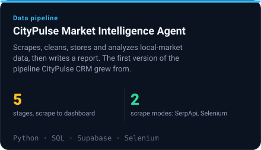
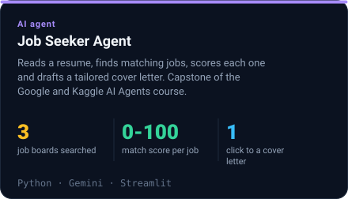
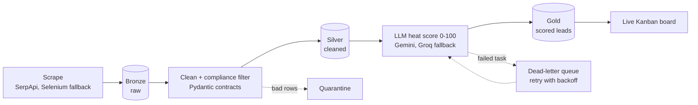

  

  <b>I build data pipelines and AI agents that check their own work.</b> 
  Built with Claude Code, Codex and Antigravity, with tests and validation gates around everything they produce.

  📍 Thrissur, Kerala, India &nbsp;·&nbsp; 🟢 Open to data engineering and AI agent roles: remote, hybrid, or on-site 
  📫 <a href="mailto:akshayev47@gmail.com">akshayev47@gmail.com</a> &nbsp;·&nbsp; <a href="https://www.linkedin.com/in/akshay-ev">LinkedIn</a>

  

  🏅 HackerRank Software Engineer certificate &nbsp;·&nbsp; 🎓 Google 5-Day AI Agents Intensive

---

## 🏆 Selected work

<!--PROJECTS:START-->
<table>
  <tr>
    <td width="50%" valign="top">
      
    </td>
    <td width="50%" valign="top">
      
    </td>
  </tr>
  <tr>
    <td width="50%" valign="top">
      
    </td>
    <td width="50%" valign="top">
      
    </td>
  </tr>
</table>
<!--PROJECTS:END-->

### How the CityPulse pipeline flows

## 🤝 How I build

- **Tests first.** For the audit agent, expected outputs were written before the code that satisfies them. A golden-output lock catches silent changes.
- **Never trust a model blindly.** In the audit agent, only one of three models passed my validation gate, so only that one is used. Every model answer goes through code that can reject it.
- **Small, reviewable changes.** One concern per branch and per PR.
- **Secrets stay out of git.** A scan runs before anything is committed or pushed.

<b>🎓 Experience, education and more projects</b>

 

**Experience**
- Full Stack Developer Intern, Xpar (May – Oct 2026)
- Website Developer Intern, Strokx Technologies (May – Jun 2025)
- Programming Intern, Keltron (Apr – May 2024): Python scripting for data processing and validation
- Lead, CUCEK Photography Club (Apr 2026 – present; member since 2023)

**Education**
- B.Tech, Information Technology, Cochin University of Science and Technology (graduating 2027)

**Also built**
- [LeadFlow Pro](https://github.com/akshayev/LeadFlow-Pro): CRM with a Kanban board and live analytics
- [TravelSphere](https://github.com/akshayev/TravelSphere): travel-booking app with an admin dashboard

